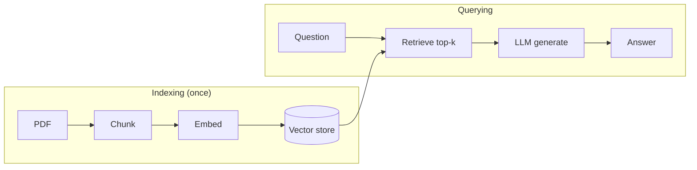
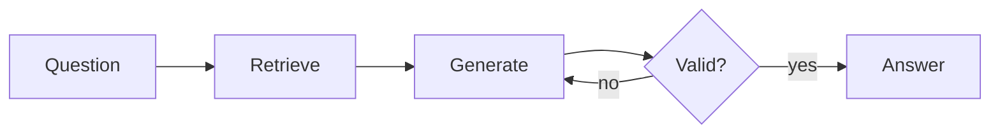
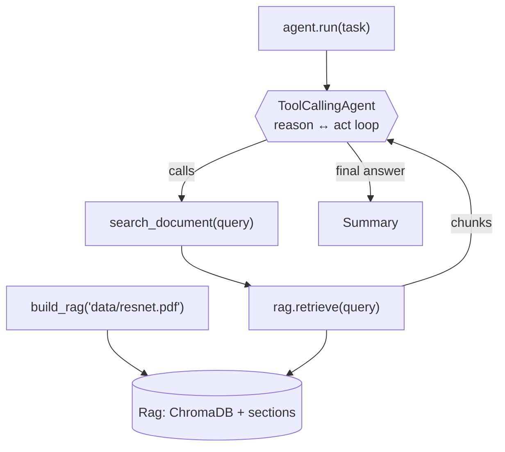
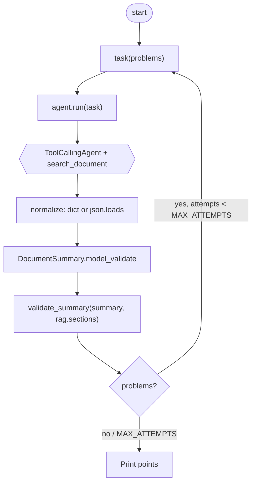
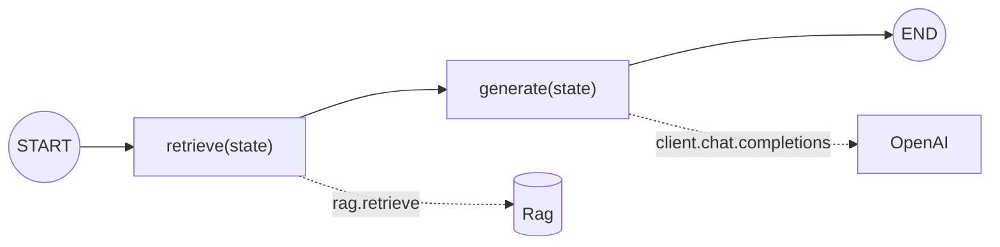
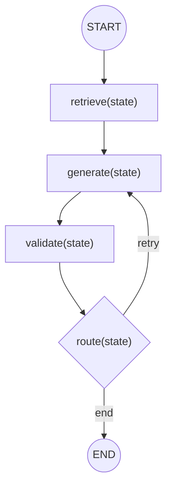
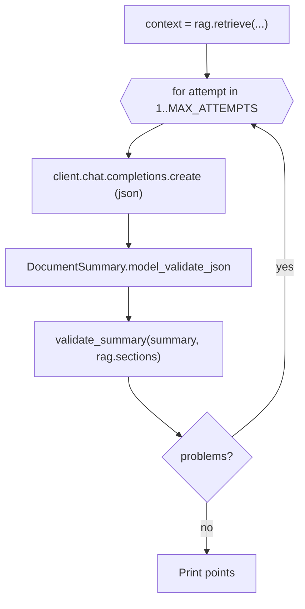
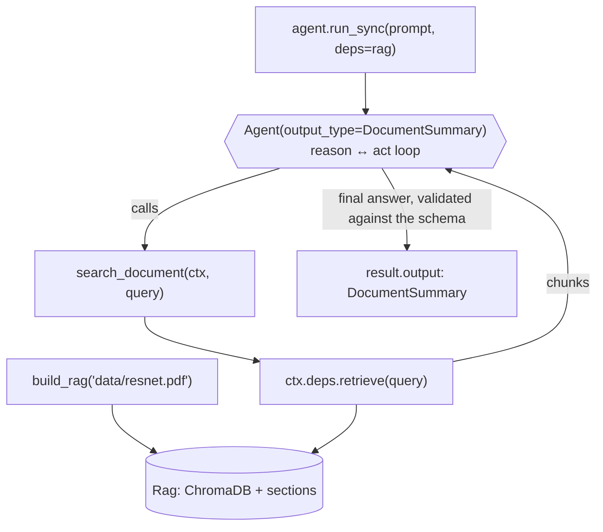
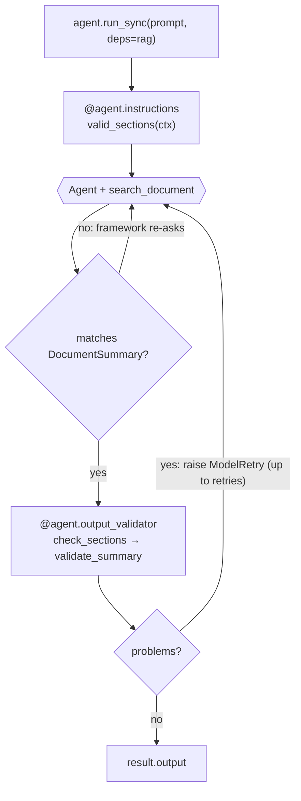

# Flow diagrams

One **generic** picture of what the RAG system does, then a **detailed** diagram per
example that mirrors the generic one but adds the real functions and their order.
(GitHub renders Mermaid automatically.)

---

## 1. Generic — what RAG does

Two phases: build the index once, then answer a query.

**Part 2** adds a check: the answer must be valid; if not, generate again.

Everything above the frameworks is **shared** (`rag_core`): `build_rag` does
PDF → chunk → embed → store, and `Rag.retrieve` does the top-k lookup. What changes per
framework is only **how the query/validation/retry flow is wired**.

---

## 2. smolagents

The RAG lives in a tool; the agent decides when to call it.

### Part 1 — basic

### Part 2 — validation + retry (our loop around `agent.run`)

---

## 3. LangGraph

The flow is an explicit state graph; the retry is a cycle in the graph.

### Part 1 — basic

### Part 2 — validation + retry (conditional edge)

State carries `context`, `summary`, `problems`, `attempts`. `route` returns `"retry"` or
`"end"` based on `problems` and `attempts`.

---

## 4. No framework (baseline)

The same part 2, written by hand: a `for` loop with the retry inline.

---

## 5. Pydantic AI

The RAG lives in a tool, like smolagents, but the output is typed and the retry is
**declarative**: an output validator raises `ModelRetry` and the framework re-asks the model.

### Part 1 — basic

### Part 2 — validation + retry (handled by the framework)

The loop in the diagram is not code we wrote: `ModelRetry` and the schema check feed the
problems back to the model, up to `retries=MAX_ATTEMPTS - 1` times.
